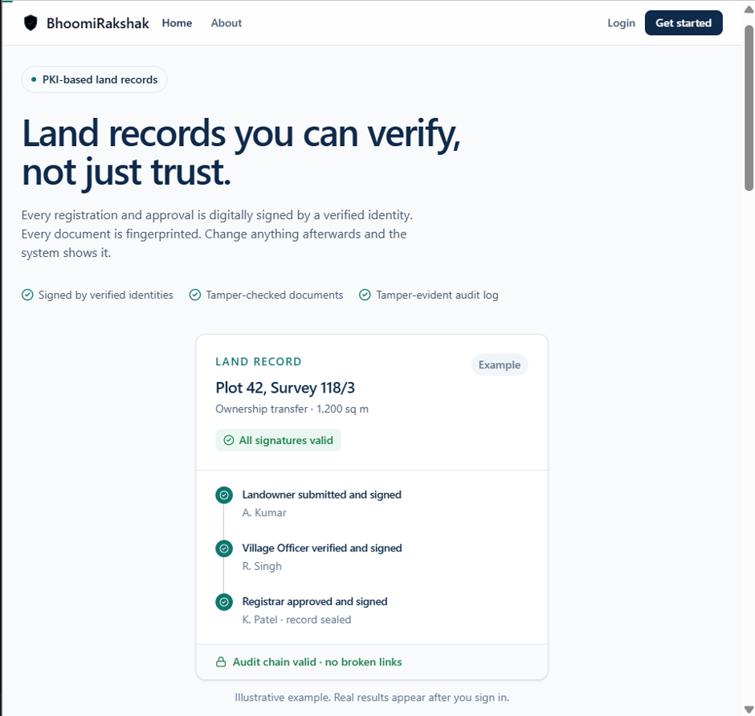
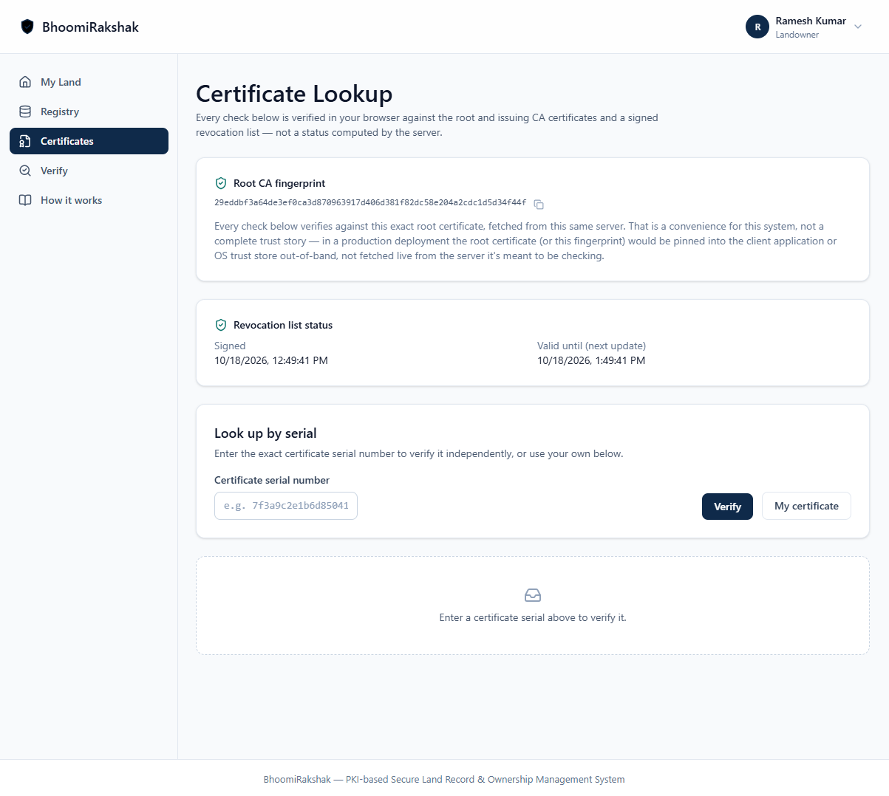
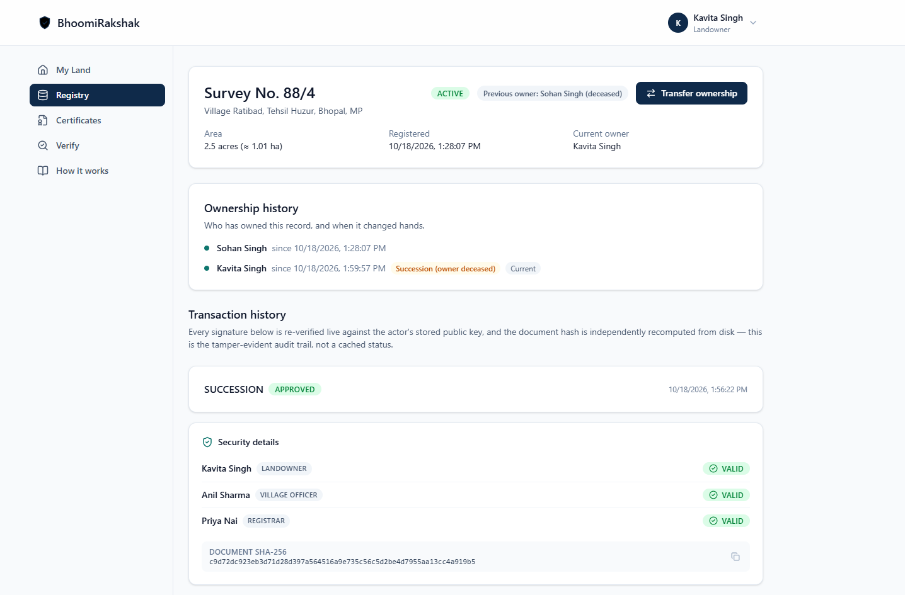
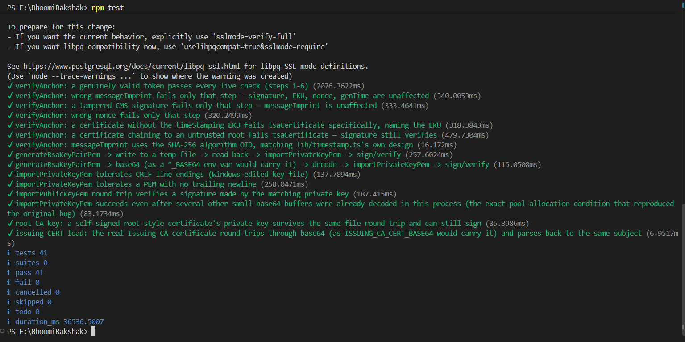
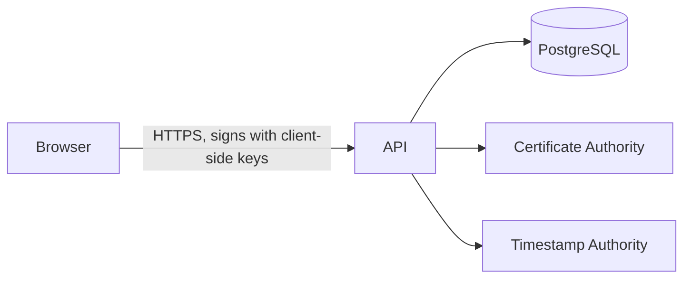

# BhoomiRakshak

BhoomiRakshak is a PKI-based land record and ownership management project.
Every user holds a CA-issued certificate and signs their own registrations,
transfers, and approvals, chained through a Landowner → Village Officer →
Registrar workflow; a separate hash-chained audit log makes any after-the-fact
tampering independently detectable. Private keys are generated and held
entirely in the browser — the server never has one in usable form.

## What it does

- Every user generates their own RSA key pair in the browser and signs their own actions — the server never holds a usable private key.
- A real two-tier X.509 CA (root → issuing) issues and revokes certificates, publishing a signed CRL.
- Land record transactions (registration, update, transfer and succession) move through a Landowner → Village Officer → Registrar approval chain, each stage cryptographically linked to the last.
- A hash-chained audit log makes any after-the-fact tampering independently detectable, periodically anchored to a public RFC 3161 timestamp authority.
- Uploaded documents are validated by magic bytes and hashed for integrity, not trusted by filename or extension.
- A self-designed attack simulation exercises forged signatures, replay, double-sale, and more — see [docs/attack-results.md](docs/attack-results.md).

## Screenshots

A full screenshot walkthrough of the project (registration, certificate lookup, signing, the three-stage approval, tamper detection, tests and design diagrams) is in **[docs/SCREENSHOTS.md](docs/SCREENSHOTS.md)**. All people, survey numbers and documents shown are fictional test data.

| | |
|---|---|
|  |  |
| Home page | Certificate lookup |
|  |  |
| Approved succession with three valid signatures | `npm test`: 41 of 41 passed |

The sample supporting documents used for the test transactions (record update, transfer agreement, death certificate, legal-heir declaration and a transfer report) are shown at the end of the walkthrough. They are fictional placeholders with no issuing authority.

## How it works



Approval flow: **Landowner → Village Officer → Registrar**, each stage's
signature chained to the ones before it.

## Tech stack

| Layer | Stack |
|---|---|
| Backend | Node.js 22+, Express 5, Prisma 7 + PostgreSQL (Neon), JWT auth, bcrypt, `@peculiar/x509`, `pkijs` and `asn1js` for X.509, CRL and RFC 3161 handling |
| Frontend | Vite, React 19, TypeScript, Tailwind CSS v4, React Router v7, axios, browser Web Crypto API |

## Quick start

Prerequisites: Node.js 22+, a PostgreSQL database (developed against Neon).

```bash
npm install
cp .env.example .env   # fill in DATABASE_URL and JWT_SECRET
npx prisma migrate dev
npm run first-run      # bootstraps the CA hierarchy and the first ADMIN
npm run dev            # starts the API on :4000

cd frontend
npm install
npm run dev            # starts the frontend on :5173
```

## Testing

`npm test` runs the unit tests (41 of 41 pass); `npm run attack-sim` runs the
attack simulation (12 of 12 blocked, recorded in
[docs/attack-results.md](docs/attack-results.md)) and must only be run against a
disposable test database;
`scripts/export-cert-check.ts` and `scripts/export-anchor-check.ts` write out
real certificates and RFC 3161 tokens for independent `openssl` verification.
Full command list and counts: [docs/testing.md](docs/testing.md). A load run
(concurrency 6, remote database) completed 27 of 27 transactions; see
[docs/load-test-results.md](docs/load-test-results.md).

## Limitations

The top items most relevant to this project's PKI/trust design — the full,
deduplicated list (client-side key custody, operational limits, etc.) is in
[docs/security.md](docs/security.md).

- **The CA is operated by this project, not a licensed Certifying Authority.**
  Real X.509 v3, two-tier (self-signed Root CA → Issuing CA → user
  certificates) — a certificate from this project verifies with `openssl` or
  any other standard X.509 tooling — but there is no real-world chain of
  trust, OCSP, or third-party attestation behind the root. Trusting it at all
  means trusting this server, by construction; see [`lib/ca.ts`](lib/ca.ts).
- **Trusted timestamping uses a public, free TSA — not a legally qualified
  one.** The RFC 3161 anchors ([`lib/timestamp.ts`](lib/timestamp.ts)) are
  cryptographically genuine — a real third party (DigiCert's public TSA by
  default) signs each token, independent of this server's own clock — but
  that TSA is not an eIDAS-qualified or CCA-licensed (India) timestamp
  authority, so it carries no legal evidentiary status. Anchoring is also
  periodic (`TSA_MIN_INTERVAL_SECONDS`), not per-entry.
- **No integration with any government land record database.**
- **Roles are chosen at registration.** There is no external identity proofing, and the system does not read or verify the content of uploaded documents (for example, a death certificate); it only hashes them.
- **The attack simulation** ([`scripts/attack-simulation.ts`](scripts/attack-simulation.ts)) is self-designed, not an independent or third-party red-team exercise.
- **The server serves the frontend's JavaScript.** A compromised server could
  serve malicious JavaScript that exfiltrates a password or signature before
  it's ever wrapped — client-side key custody protects against a server that
  merely reads its own database, not one that has been fully compromised. See
  [docs/security.md](docs/security.md).
- **Forgetting your password loses your key, permanently** — there is no
  password reset or key backup/escrow by design.

## Trust anchor

The Certificate Lookup page shows a root CA fingerprint it fetched from this
same server — convenient, but not by itself a trust story (see
[`lib/ca.ts`](lib/ca.ts) and the Limitations above). To actually confirm it,
compute the fingerprint independently, out-of-band, from the root certificate
file itself, and compare the two by eye:

```bash
openssl x509 -in keys/root-ca-cert.pem -noout -fingerprint -sha256
```

(`openssl` prints colon-separated hex, uppercase; the lookup page prints the
same bytes as plain lowercase hex — ignore punctuation and case, compare only
the hex digits themselves.) If they don't match, stop trusting the server's
answer — something between you and it (or the server itself) isn't what it
claims to be. In a real deployment this comparison value would be pinned into
the client application or OS trust store ahead of time, not fetched live from
the thing it's meant to be checking.

## Documentation

- [docs/SCREENSHOTS.md](docs/SCREENSHOTS.md) — screenshot walkthrough
- [docs/architecture.md](docs/architecture.md) — client-side signing, technical design, project structure
- [docs/deployment.md](docs/deployment.md) — deployment guide (Neon, Render, Vercel)
- [docs/configuration.md](docs/configuration.md) — environment variable reference
- [docs/testing.md](docs/testing.md) — test commands and counts
- [docs/security.md](docs/security.md) — full list of security/trust limitations
- [docs/ui.md](docs/ui.md) — design system (color tokens, routes)
- [docs/attack-results.md](docs/attack-results.md) — latest attack simulation results
- [docs/load-test-results.md](docs/load-test-results.md) — load run results